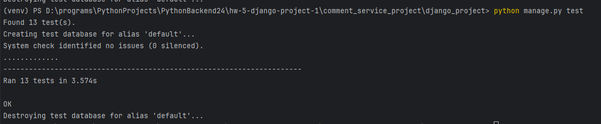

Команды для запуска проекта

```
python manage.py makemigrations
python manage.py migrate
```

Очистка базы данных и добавление мок данных.
```
python manage.py flush
python manage.py loaddata mock_data.json
```
Пример запроса и результат с мок данными.


Докер
Команда для контейнера

```
cd .\comment_service_project\
docker-compose -f storage/docker-compose.yml build
docker-compose -f storage/docker-compose.yml up -d
```


Тесты
Запускаются с помощью
```
python manage.py test
```
Результаты тестов
