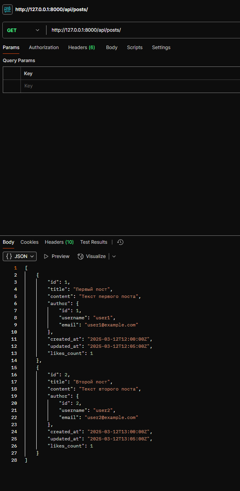
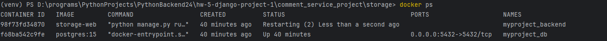

Команды для запуска проекта

```
python manage.py makemigrations
python manage.py migrate
```

Очистка базы данных и добавление мок данных.
```
python manage.py flush
python manage.py loaddata mock_data.json
```
Пример запроса и результат с мок данными.



Докер
Команда для контейнера

```
cd .\comment_service_project\storage\
docker build -t myproject .
```
